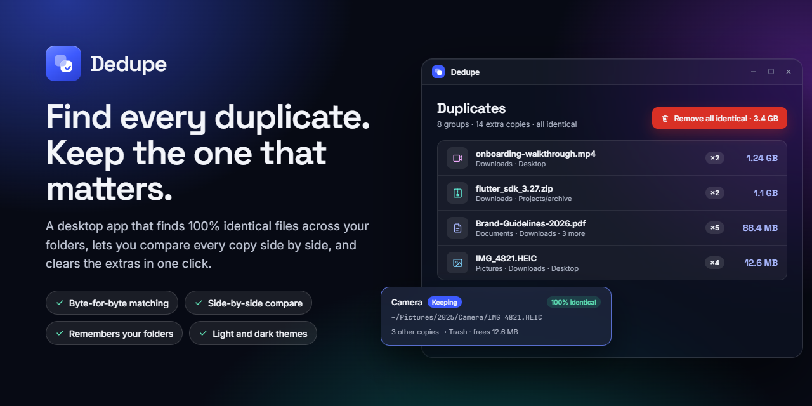

# Dedupe



Dedupe is a Windows desktop app (built with Flutter) that finds duplicate files. Pick one or more folders, and it scans them, groups files by content, and lets you review and remove the duplicates.

## Features

- Drag-and-drop or file-picker folder selection
- Fast duplicate detection: size grouping, then partial hash, then full hash, with optional byte-by-byte verification
- Native (C++ / FFI) hashing for speed, with bounded parallel I/O in worker isolates
- Persistent hash cache (ObjectBox), so repeat scans are quick
- Cancellable scans with stage-relative progress
- Scan history, settings, and a custom dark theme

## Tech stack

| Area | Packages |
| --- | --- |
| State management | `flutter_bloc`, `equatable` |
| Dependency injection | `get_it` |
| Navigation | `go_router` |
| Models / codegen | `freezed`, `json_serializable`, `build_runner` |
| Local database | `objectbox` |
| Native hashing | `dart:ffi`, `ffi`, C++ (`ffi/hash_native`) |
| Desktop window / input | `bitsdojo_window`, `desktop_drop`, `file_selector` |
| Packaging | `msix` |

## Prerequisites

- **Windows 10 or 11** (the app and its native library target Windows)
- **Flutter 3.41.9** (Dart SDK `^3.11.3`). The repo pins this version through [FVM](https://fvm.app) in `.fvmrc`.
- **Visual Studio 2022** with the **Desktop development with C++** workload. It includes the MSVC toolchain and CMake needed to build the native `hash_native.dll`.
- **Developer Mode** turned on in Windows (Settings > System > For developers). Flutter needs it for plugin symlinks.
- Git

Run `flutter doctor -v` and confirm the Windows toolchain is green before you continue.

## Project setup

```powershell
# 1. Clone
git clone <repo-url> filesieve
cd filesieve

# 2. (Recommended) install the pinned Flutter version with FVM
dart pub global activate fvm
fvm install
#    Then prefix the commands below with `fvm`, e.g. `fvm flutter run`.

# 3. Fetch dependencies
flutter pub get

# 4. Generate code (freezed, json_serializable, ObjectBox)
dart run build_runner build --delete-conflicting-outputs
```

Step 4 is needed whenever you change a `@freezed` / `@JsonSerializable` model or an ObjectBox entity. While developing you can use `dart run build_runner watch --delete-conflicting-outputs` instead.

## Run the app

```powershell
flutter run -d windows
```

The first run is slow because it also compiles the native hash library (`ffi/hash_native`) through `windows/CMakeLists.txt`. It is placed next to the executable as `hash_native.dll`, and the app loads it at runtime.

## Tests and analysis

```powershell
flutter analyze
flutter test
```

## Build the MSIX package

MSIX settings live under `msix_config` in [pubspec.yaml](pubspec.yaml):

| Key | Value |
| --- | --- |
| `display_name` | Dedupe |
| `publisher_display_name` | Binate Solutions |
| `identity_name` | `com.binatesolutions.filesieve` |
| `msix_version` | `1.0.1.0` |
| `logo_path` | `windows/runner/resources/app_icon.ico` |
| `capabilities` | `internetClient` |

### 1. Build the release app and create the package

```powershell
flutter build windows --release
dart run msix:create
```

`msix:create` runs the Windows release build if needed, packages `build\windows\x64\runner\Release`, and writes the installer to:

```
build\windows\x64\runner\Release\filesieve.msix
```

To skip the rebuild when you have just run `flutter build windows --release`:

```powershell
dart run msix:create --build-windows false
```

### 2. Versioning

Bump both values together before each release:

- `version:` in `pubspec.yaml` (for example `1.0.1+2`)
- `msix_version:` in `msix_config` (four parts, for example `1.0.1.0`). The last part must be `0` for Microsoft Store submissions.

### 3. Install locally

Without a code-signing certificate, the `msix` package signs with a self-signed test certificate, which Windows must trust before it installs the package. Either:

- Run `dart run msix:create --install-certificate true` (needs an elevated PowerShell) so the certificate is installed for you, or
- Double-click the `.msix` file and follow the prompt. If Windows refuses because the publisher is untrusted, install the certificate first (right-click the `.msix` > Properties > Digital Signatures > Details > View Certificate > Install Certificate > Local Machine > Trusted People).

To uninstall: Settings > Apps > Installed apps > Dedupe.

### 4. Distribute

For real distribution, sign with a certificate from a trusted CA, or publish through the Microsoft Store. Pass your certificate to the build, and set `publisher` to the exact subject of that certificate:

```powershell
dart run msix:create --certificate-path <path-to.pfx> --certificate-password <password>
```

## Project structure

```
lib/
  main.dart            App entry point, DI setup, router
  models/              Freezed / ObjectBox data models
  modules/             Screens and their cubits (home, loading, results, history, settings)
  repository/          Settings, cache paths, scan sessions, file removal
  utils/               Duplicate finder, hashing (FFI bindings), file walker, helpers
  values/              Routes, theme, enums
ffi/
  hash_native/         C++ hashing library, built by windows/CMakeLists.txt
  video_thumbnail_extract/   C++ video-thumbnail helper (FFmpeg); not part of the default Windows build
assets/fonts/          Inter, Space Grotesk, JetBrains Mono
files/                 Design prototypes, logo sheet, algorithm notes, MSIX package
test/                  Unit and widget tests
```

## Troubleshooting

- **`hash_native.dll` not found at runtime**: do a clean native rebuild with `flutter clean`, then `flutter run -d windows`. Check that the Visual Studio C++ workload is installed.
- **Missing `*.g.dart` / `*.freezed.dart` / `objectbox.g.dart` errors**: run the `build_runner` command from the setup section.
- **Symlink errors on `flutter pub get`**: enable Windows Developer Mode.
- **MSIX installs but won't launch**: confirm you packaged the `Release` build, not `Debug`.
